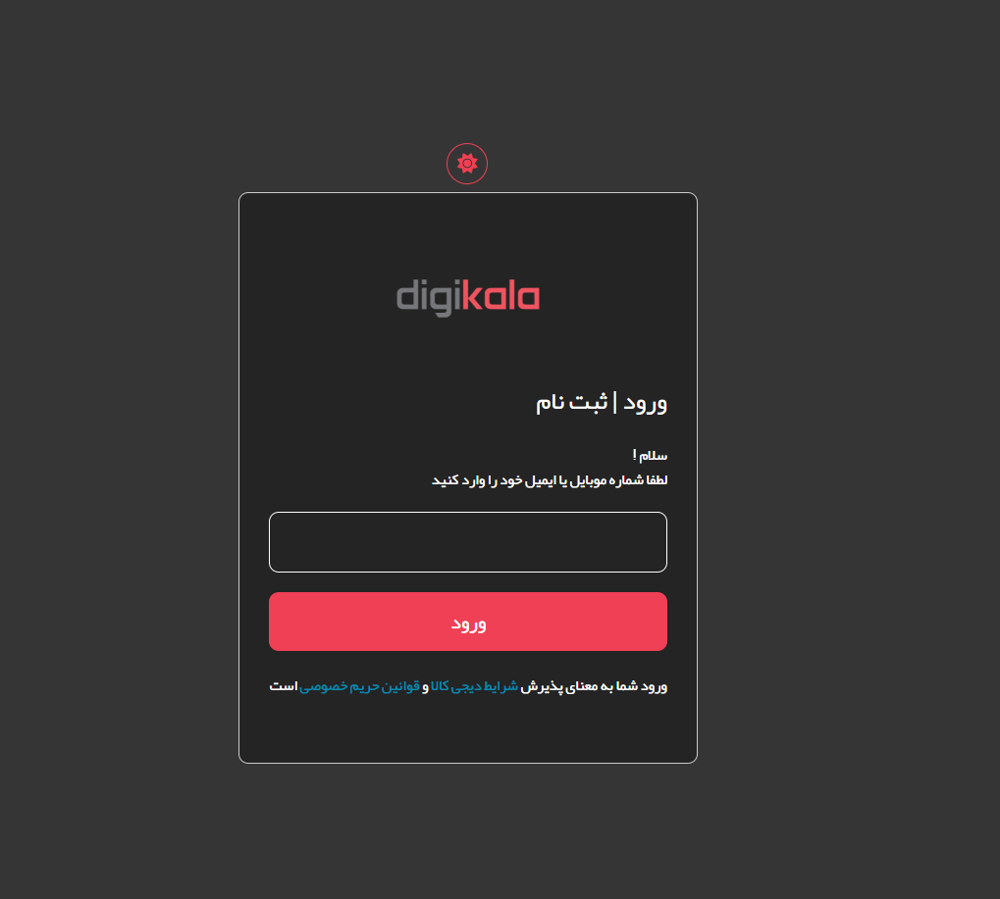
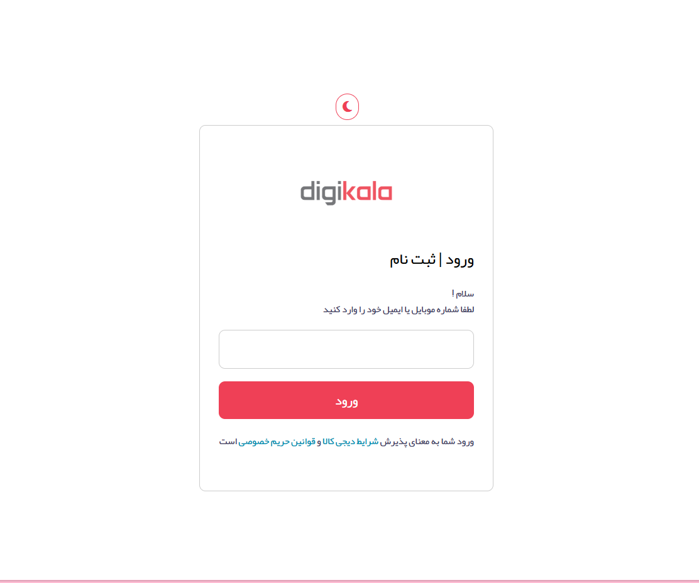

# Degikala login

A Persian, RTL login page inspired by Digikala, one of Iran's popular e-commerce platforms. This project focuses on recreating the login interface with a clean layout and a light/dark theme toggle.

## Preview

## Features

Persian language interface with RTL layout

Light and dark mode toggle

Clean and minimal login UI

Custom Yekan font

Font Awesome icons

Tailwind CSS styling

## Built With

HTML5

Tailwind CSS

JavaScript

Font Awesome

## What I Learned

How to use Tailwind CSS for styling and layout.

How to manipulate the DOM using JavaScript.

How to implement a light/dark mode toggle.

How to organize project files and manage assets such as fonts and icons.

How to use Git and GitHub to manage and publish a project.

How to write clear project documentation using Markdown.